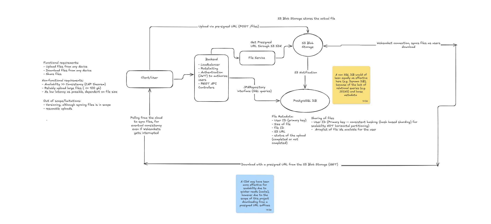

# User Management API


## Project Overview

A full-stack, Dropbox-style cloud storage service where users sign up (email/password, Google or GitHub) and upload, download and share files from any device. A Spring Boot API with PostgreSQL handles identity, authorization and file metadata, while the files themselves live in Amazon S3, so large transfers never have to squeeze through the application servers. It is designed to favour availability over strict consistency, keeping devices in sync over WebSockets with polling as an eventual-consistency fallback.

> [!NOTE]
> **Status:** authentication, customer management and S3 storage for profile images are implemented in this repository. The file upload, download, sync and sharing architecture described under [System design](#system-design) is the target design for the project.

## Features

### Implemented

**Authentication & authorization**

- Email/password registration and login with BCrypt-hashed passwords. `POST /api/v1/customers` (register) and `POST /api/v1/auth/login` both return a signed JWT in the `Authorization` response header.
- `JWTAuthFilter` reads the bearer token on each request, loads the user and populates the Spring Security context. Tokens are HS256-signed (jjwt), expire after 15 days, and the signing key is configurable through `JWT_SECRET_KEY`.
- Google and GitHub sign-in through Spring Security's OAuth2 client: on first login a customer record is created, the API issues its own JWT and redirects to the React callback page. The OAuth flow switches on when client registrations are available.
- A `Role` model (`ADMIN`, `USER`) mapped to Spring authorities, explicit public vs. protected routes, property-driven CORS, and authentication errors routed through Spring MVC's exception resolver (`DelegatedAuthEntryPoint`).

**Customer management API** (`/api/v1/customers`)

- Register, list, fetch, update and delete customers. Updates are partial: only changed fields are applied, and no-op requests are rejected.
- Domain exceptions map to clear HTTP statuses: `404` not found, `409` duplicate email, `400` invalid update.
- Responses use `CustomerDTO`, so password hashes never leave the service layer.

**S3 file storage (profile images)**

- `POST /api/v1/customers/{id}/profile-image` accepts a multipart upload (10 MB limit) and stores it in S3 under `profile-images/{customerId}/{uuid}`; only the generated UUID is saved in PostgreSQL.
- `GET /api/v1/customers/{id}/profile-image` returns the image as `image/jpeg`. This route is public so the frontend can use it directly in an `` tag.
- Region and bucket come from configuration (`aws.region`, `aws.s3.buckets.customer`), and the S3 client uses the default AWS credential chain.

**Persistence**

- Schema owned by Flyway migrations (`V1__init.sql`); Hibernate runs in `validate` mode and never alters it.
- A `CustomerDao` abstraction with a Spring Data JPA implementation (`JPACustomerDataAccessService`), so the service layer doesn't depend on the persistence technology.
- Database-enforced integrity: unique email, unique profile-image ID and sequence-generated IDs.

**React frontend**

- Login, sign-up and OAuth-callback pages, a protected dashboard (`ProtectedRoute`) and an `AuthContext` that keeps the JWT in `localStorage`.
- The dashboard uploads a profile image and previews the stored one; the API base URL comes from `VITE_API_BASE_URL`.

**Developer experience & operations**

- Testcontainers setup (PostgreSQL 16) for integration tests, plus `TestUserManagementApiApplication` to run the app against a throwaway database.
- Spring Boot Actuator for health checks.
- Environment-specific values and secrets (`JWT_SECRET_KEY`, OAuth client IDs and secrets, `FRONTEND_URL`) can be overridden with environment variables.

### System design



**Requirements**

| Category | Requirements |
|---|---|
| Functional | Upload files from any device · Download files from any device · Share files |
| Non-functional | Availability over consistency (CAP theorem) · Reliable uploads of large files (up to 100 GB) · As low latency as possible, depending on file size |
| Out of scope | Versioning (syncing files is still in scope) · Resumable uploads |

**How it works**

1. **Gatekeeping.** Every request enters through the backend, where a load balancer, rate limiting and JWT authorization sit in front of the REST controllers.
2. **Upload** (`POST /files`). The backend's File Service asks the S3 SDK for a pre-signed URL, and the client uploads the file straight to S3 with it.
3. **Upload tracking.** A metadata record is kept in PostgreSQL through the JPA repository layer. When the object lands in S3, an S3 event notification updates the record so its upload status moves from *not completed* to *completed*.
4. **Download.** The client downloads directly from S3 using a pre-signed `GET` URL.
5. **Sync.** Devices stay in sync over a WebSocket connection as files are downloaded. Polling the cloud is the fallback that guarantees eventual consistency when the socket is interrupted.
6. **Sharing.** A per-user record lists the IDs of the files available to that user, sharded by user ID with consistent hashing.

**Data model**

| Store | Record | Fields |
|---|---|---|
| S3 blob storage | The file itself | File bytes |
| PostgreSQL (file metadata) | One per file | User ID, file ID, file size, S3 URL, upload status (completed / not completed) |
| Sharing records | One per user | User ID (shard key), list of file IDs available to the user |

### Engineering decisions

- **Pre-signed URLs for direct-to-S3 transfers.** The API authorizes the request and hands out a time-limited URL; file bytes flow between the client and S3 and never through the application servers. That keeps the API tier light, lets large files (design target: up to 100 GB) upload without tying up backend threads or memory, and makes latency depend on file size and the client's connection rather than backend capacity.
- **Metadata and blobs live in different stores.** S3 holds the bytes (durable, effectively unlimited); PostgreSQL holds small structured records (owner, size, S3 location, upload status). Each scales on its own terms and neither is forced into a job it is bad at.
- **Availability over consistency (AP in the CAP theorem).** Sync is eventually consistent by design: WebSockets give low-latency updates, polling guarantees convergence if a connection drops, and no client has to wait for a globally consistent view before it can work.
- **Event-driven upload status.** S3 notifications update the metadata record, so the backend never has to sit in the upload path or hold a request open to learn that an upload finished. The explicit completed / not-completed flag keeps unfinished uploads distinguishable from finished files.
- **Consistent hashing for sharing data.** Sharding by user ID with consistent hashing spreads users evenly across shards and limits how much data moves when shards are added or removed. It was chosen over plain horizontal partitioning for scalability.
- **Protection at the edge.** Load balancing, rate limiting and JWT authorization run before any controller logic, so unauthenticated or abusive traffic is rejected before it can request upload URLs or reach the database.

**Trade-offs and alternatives considered**

- **NoSQL for metadata.** A store such as DynamoDB would have been equally effective: file metadata has no relational queries (JOINs) and is loosely structured. PostgreSQL is used here, alongside the user data.
- **CDN for downloads.** A CDN would scale reads better through caching, but within the scope of this project downloading from a pre-signed URL is sufficient.
- **Large uploads.** S3 caps a single-request upload at 5 GB, so the 100 GB target would rely on multipart uploads. Resumable uploads and versioning are deliberately out of scope for now.

## Tech Stack & Project Structure

### Languages

| Language | Used for | Why it matters here |
|---|---|---|
| **Java 21** (LTS) | Backend API (`backend/`) | Statically typed and long-term supported, which matters in authentication and persistence code where compile-time checks catch mistakes early. Its ecosystem (Spring Security, the AWS SDK, jjwt) supplies mature libraries for exactly this project's problems, and modern features such as records keep DTOs and request bodies short and immutable (`CustomerDTO`, `RegistrationRequest`, `AuthRequest`). |
| **JavaScript (JSX)** | Frontend (`frontend/`) | The browser's native language. React's component model and hooks keep auth state, forms and upload feedback easy to reason about, and because the backend is a plain REST API, any client (web or mobile) can consume it. |
| **SQL** | Flyway migrations, JPQL | The schema is defined explicitly in versioned SQL (sequence, constraints, unique indexes) instead of being generated by the ORM, so database changes are reviewable and repeatable. |
| **YAML** | `application.yaml`, `docker-compose.yml` | One readable place for datasource, OAuth, CORS, JWT and AWS settings, with `${ENV_VAR:default}` overrides for secrets and environment-specific values. |

### Frameworks, libraries and services

| Area | Technology | Why |
|---|---|---|
| Web framework | **Spring Boot 4.1** (Spring MVC, Security, Data JPA, Actuator) | Convention over configuration, with one consistent model for REST, security, data access and health checks. |
| Security | **Spring Security**, **jjwt**, **BCrypt**, **Spring OAuth2 Client** | A filter chain for authorization, signed self-contained JWTs so any device can call the API with its own credentials, BCrypt for password storage, and OAuth2 for Google/GitHub sign-in. |
| Data access | **Spring Data JPA / Hibernate** | Repository abstraction removes boilerplate and sits behind the `CustomerDao` interface. |
| Database | **PostgreSQL** | ACID relational store for accounts and file metadata, enforcing uniqueness and integrity. |
| Migrations | **Flyway** | Versioned, repeatable schema changes. |
| Object storage | **Amazon S3** via the **AWS SDK for Java v2** | Durable, scalable storage for file bytes, with pre-signed URL support for direct client-to-S3 transfers. |
| Frontend | **React 18**, **React Router 6**, **Vite 5** | Component-based UI, client-side routing with protected routes, and a fast dev server and build. |
| Testing | **Testcontainers** | Tests run against a real PostgreSQL 16 container instead of an in-memory substitute, so behaviour matches production. |
| Build & local infrastructure | **Maven**, **Docker Compose** | Reproducible builds and a containerised local database. |

### Project structure

```text
.
├── docker-compose.yml                  # Local PostgreSQL via Docker Compose
├── docs/
│   └── system-design.png               # Architecture diagram shown above
├── backend/                            # Spring Boot REST API (Java 21, Maven)
│   ├── pom.xml
│   └── src/
│       ├── main/
│       │   ├── java/com/notpoggoez/
│       │   │   ├── UserManagementApiApplication.java
│       │   │   ├── Auth/               # Login endpoint (AuthController, AuthRequest)
│       │   │   ├── Customer/           # Users: entity, controller, service, DAO + JPA implementation, DTOs, enums
│       │   │   ├── Security/           # Filter chain, CORS, password encoder, UserDetailsService, OAuth2 login handler
│       │   │   ├── jwt/                # JWTUtil (issue/parse tokens) and JWTAuthFilter
│       │   │   ├── S3/                 # S3 client config, typed bucket properties, S3Service
│       │   │   └── Exception/          # Custom HTTP exceptions, delegated auth entry point
│       │   └── resources/
│       │       ├── application.yaml    # Datasource, OAuth2, CORS, JWT and AWS settings
│       │       └── db/migration/       # Flyway migrations (V1__init.sql)
│       └── test/java/com/notpoggoez/user_management_api/   # Testcontainers config and context test
└── frontend/                           # React 18 + Vite single-page app
    ├── index.html · vite.config.js · package.json · .env
    └── src/
        ├── main.jsx · App.jsx · styles.css
        ├── api/client.js               # fetch wrapper: base URL + auth header
        ├── context/AuthContext.jsx     # JWT state, persisted in localStorage
        ├── components/ProtectedRoute.jsx
        └── pages/                      # Login, Signup, OAuthCallback, Dashboard
```

**Why it is organised this way**

- **Feature packages, layered inside.** `Customer/` follows controller → service → DAO → repository: controllers only translate HTTP, services hold the rules (duplicate checks, partial updates), and the `CustomerDao` interface hides how data is stored. Swapping the persistence technology touches one class, and services can be tested against the interface.
- **Security is isolated.** `Security/` and `jwt/` hold everything about authentication, so business code never deals with tokens or password hashing, and the JWT filter plugs into the filter chain in a single place.
- **Cloud access behind one seam.** All S3 calls go through `S3Service`, with bucket names in typed `S3Buckets` properties. The rest of the code never touches the AWS SDK, so moving to the pre-signed URL flow described above is a local change.
- **One place for error semantics.** Custom exceptions carry their HTTP status (`@ResponseStatus`), and `DelegatedAuthEntryPoint` pushes security errors through Spring MVC's exception resolver, so errors are handled in one place.
- **Frontend by responsibility.** `api/` isolates HTTP calls, `context/` holds global auth state, `components/` holds reusable pieces and `pages/` holds route-level screens, so new features such as file lists and sharing slot in without restructuring.
- **One repository, two independent apps.** `backend/` and `frontend/` build and run separately (Maven vs. npm/Vite) but live together, so API and UI changes ship in the same pull request.
